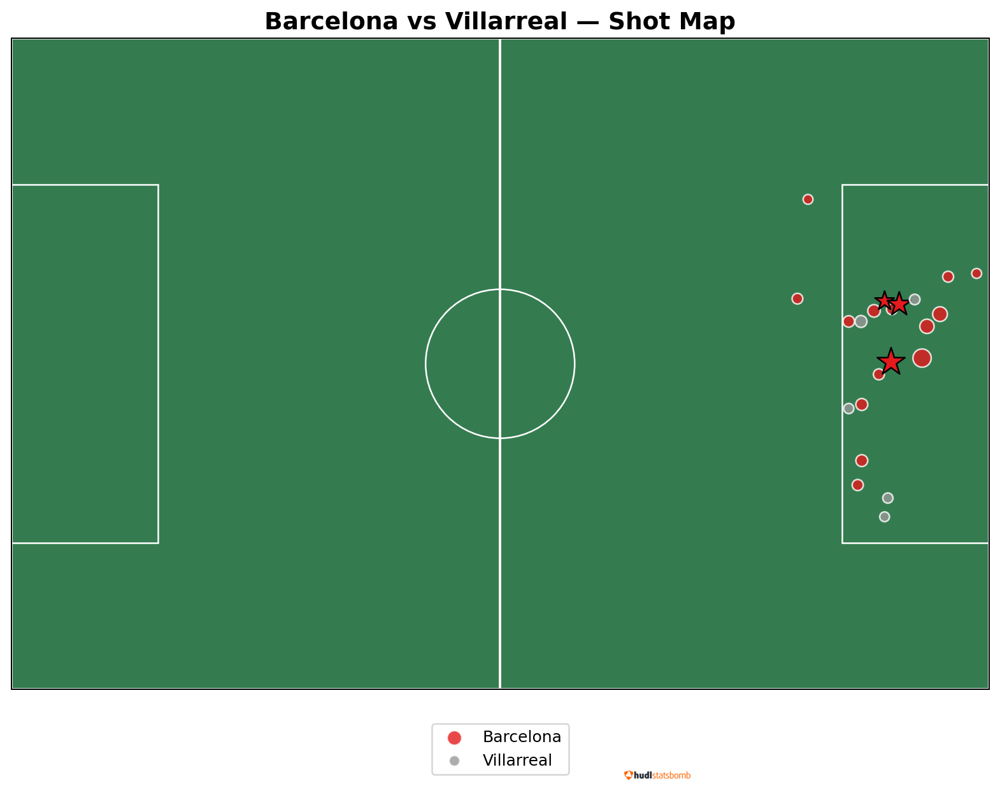
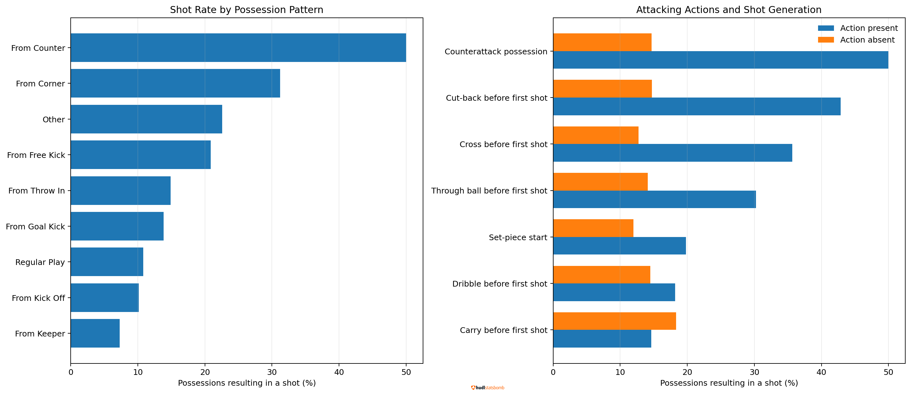
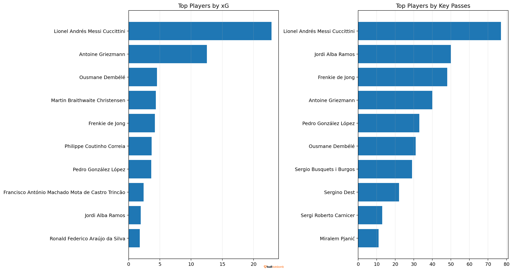
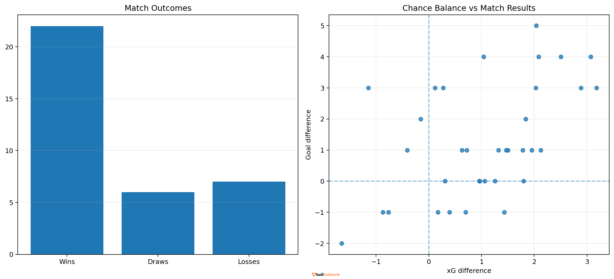

# Decoding Barça
## Football Data Analysis — FC Barcelona 2020/21

An exploratory football analytics project investigating FC Barcelona's
attacking performance, chance creation, player contributions, and
match outcomes using StatsBomb Open Data.

## Project Overview

This project uses Python to investigate how Barcelona created chances,
which players contributed to attacking actions, and how expected-goal
metrics related to match results.

### Research Questions

1. How did Barcelona's shooting output compare with its opponents?
2. Which attacking patterns were associated with shot generation?
3. Which players contributed most to goals, chance creation, and progression?
4. How did xG differences relate to actual match outcomes?

## Dataset and Scope

- Competition: La Liga
- Season: 2020/2021
- Matches with available event data analyzed: **35**
- Data source: StatsBomb Open Data

The analysis covers only the fixtures represented in the downloaded
open-data files. It should not be interpreted as a complete 38-match
season analysis unless full match coverage has been independently verified.

Data: https://github.com/statsbomb/open-data

## Key Descriptive Results

| Metric | Result |
|---|---:|
| Matches analyzed | 35 |
| Wins | 22 |
| Draws | 6 |
| Losses | 7 |
| Average goals scored per match | 2.31 |
| Average xG difference per match | 1.046 |

### Player leaders in the analyzed event data

- Top scorer by recorded goals: Lionel Andrés Messi Cuccittini (30 goals)
- Top player by recorded key passes: Lionel Andrés Messi Cuccittini (77 key passes)

These are raw totals, not per-90 rankings. They depend on the available
match coverage and player appearances represented in event data.

## Investigations

### 1. Match Analysis
Barcelona vs Villarreal: shots, goals, expected goals, and shot locations.

### 2. Attacking Patterns
Possession start patterns and attacking actions associated with shots.

### 3. Player Contributions
Goals, xG, key passes, assists, passing, and progressive actions.

### 4. Season Outcomes
Match results, goals, expected goals, and chance balance.

## Tools and Technologies

- Python
- Pandas
- NumPy
- Matplotlib
- Seaborn
- Jupyter Notebook
- StatsBomb Open Data

## Methodological Notes and Limitations

- Available open-data fixtures do not necessarily cover all league matches.
- xG is an estimate of the quality of a shot, not a guarantee of scoring.
- The linked-shot xA measure is a custom proxy, not an official StatsBomb xA metric.
- Progressive-pass thresholds are project-defined and use inferred direction.
- Event totals are not adjusted for minutes played.
- Possession/action comparisons are descriptive associations, not causal conclusions.
- Player metrics should not be interpreted as official provider rankings.

## Reproducing the Analysis

1. Install the packages listed in `requirements.txt`.
2. Obtain the event and match data from StatsBomb Open Data.
3. Follow the data preparation and analysis instructions in `data/README.md`.
4. Open `notebooks/Barcelona_Football_Analytics.ipynb`.
5. Run the notebook cells in order.

## Attribution

Event data provided by StatsBomb.

This project is an independent educational analysis and is not affiliated
with or endorsed by FC Barcelona or StatsBomb.

Please consult the original data source's terms before reusing or
redistributing its data.

Source: https://github.com/statsbomb/open-data
